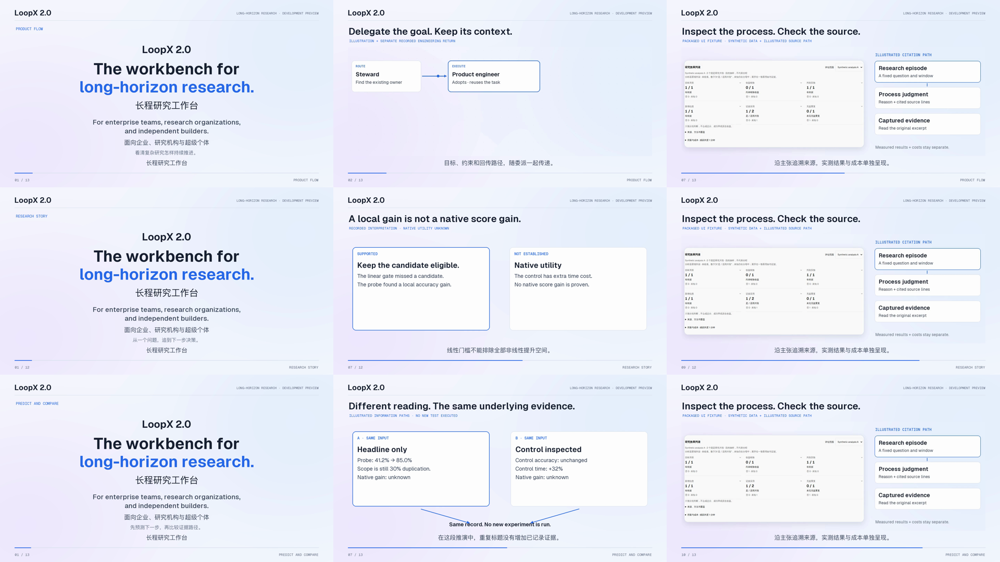

# LoopX 2.0 · 三版研究工作台影片

长程研究工作台，面向企业、研究机构与超级个体。

2.0 开发预览，候选待选，不表示已正式发布。

| 版本 | 讲什么 | 观看与文字稿 |
| --- | --- | --- |
| A · 产品流程 · 79.2s | 从目标和委派，经过研究历史、证据与成本，到下一步。 | [MP4](https://github.com/user-attachments/assets/3b375d83-f275-41a1-bca1-94fc877efca4) · [EN](loopx-research-a.transcript.md) · [中文](loopx-research-a.transcript.zh-CN.md) |
| B · 研究故事 · 82.8s | 一个图分类问题：保留非线性候选，也保留反例与额外成本。 | [MP4](https://github.com/user-attachments/assets/7e012d01-580e-40d0-9d94-c338f70c57d3) · [EN](loopx-research-b.transcript.md) · [中文](loopx-research-b.transcript.zh-CN.md) |
| C · 机制推演 · 87s | 暂停预测，再比较同一记录的两条信息路径；没有新模拟实验。 | [MP4](https://github.com/user-attachments/assets/0eb29457-4244-4ee4-9a34-ce562074d46c) · [EN](loopx-research-c.transcript.md) · [中文](loopx-research-c.transcript.zh-CN.md) |

每版均有英文旁白、画面中文字幕、中英文 VTT/SRT 和逐句文字稿。播放器支持外部字幕时，可加载对应 VTT 或 SRT。密集界面建议全屏或配合文字稿阅读。

## 素材与判断边界

- 委派图示结合单独的软件工程实录回传；研究历史是另一份实录，不能拼成同一真实执行。
- 看板和控制设置使用已公开的工作区场景。轨迹分析使用打包 UI 的合成数据；六类过程判断未经科学校准，不产生总分。引用路径为示意。
- 图分类记录来自两个 CPU 线程、完整尺寸生成联合邻域图的30%局部重复条件：准确率41.2%→85.0%。独立边对照准确率未变、耗时+32%。它支持继续检验非线性候选，原生分数收益仍未知；不构成 LoopX 与基线的因果收益。
- 带水印的 Seedance 2.5 概念镜头复用旧素材；其余新增画面由代码绘制。没有新增远程生成或 benchmark 执行。
- 企业和机构是受众定位，不表示已验证企业部署、安全、SLA或多租户；历史1.0.3 LHTB结果不改称2.0实测。

[Historical fixed source / 历史固定来源](https://github.com/loopx-project/loopx/blob/c9c3adf63f9771ef95f1fcca12b11ed7de1f69eb/apps/presentation/site/public/lab/time-machine/data/graph.json) · [Assessment contract / 分析契约](../../reference/trajectory-assessment.md)

[Original58s film / 保留的原58秒影片](loopx-research-workbench.mp4) · [Original transcript / 原文字稿](loopx-research-workbench.transcript.zh-CN.md)
