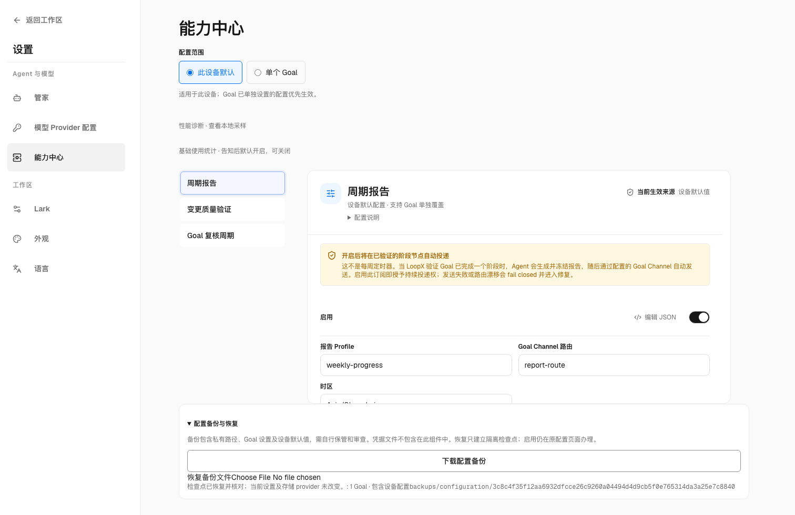
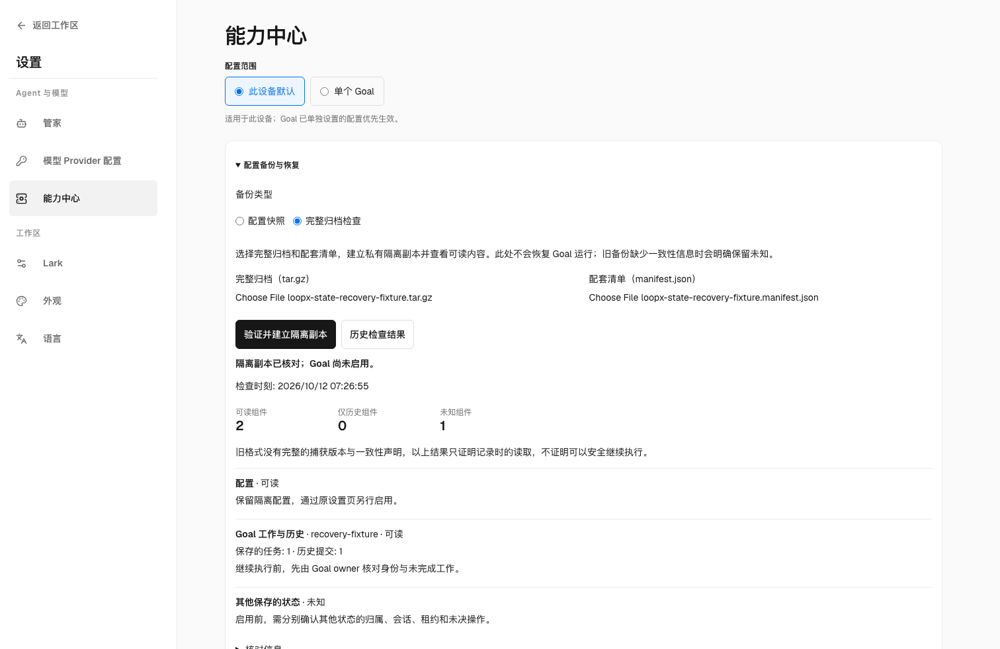
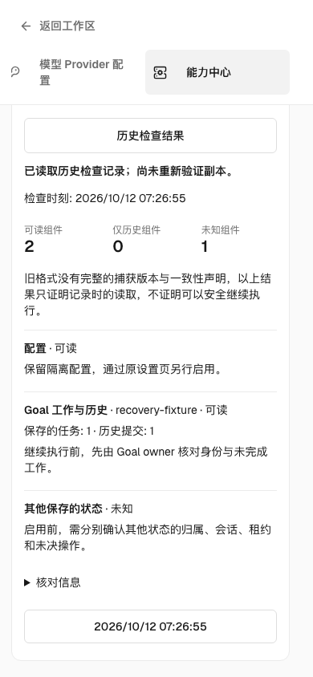

# Configuration backup and recovery

`backup-state --execute` includes a first-class `configuration-backup.json`
component beside the physical archive. It captures the stored machine
configuration and complete source-owned Goal registry rows, including explicit
capability overrides, storage intent, extension fields, nulls and disabled
values. It resolves shared registry entries to their canonical project registry;
an effective/public settings projection cannot replace the stored configuration.
Unreadable or ambiguous source ownership aborts publication of the backup.
Capture compares the complete transport result with its source values; an
unrepresentable value (such as an integer rounded by JavaScript) aborts instead
of publishing a lossy checkpoint or replacing an earlier backup.

Use a configuration-only backup without copying databases, Host sessions,
credential stores, skill directories or automation state:

```sh
loopx --runtime-root /absolute/runtime --registry /absolute/registry.json \
  --format json configuration-backup export --goal-id example \
  --output /absolute/operator-owned/configuration.json
# Review scope, then repeat with --execute. Export never replaces an existing file.
loopx --runtime-root /absolute/runtime --registry /absolute/registry.json \
  --format json configuration-backup export --goal-id example \
  --output /absolute/operator-owned/configuration.json --execute
loopx --format json configuration-backup verify \
  --input /absolute/operator-owned/configuration.json
loopx --format json configuration-backup restore \
  --input /absolute/operator-owned/configuration.json \
  --expected-sha256 SHA256_FROM_VERIFY --destination /absolute/new-checkpoint
# Review, then repeat with --execute.
```

Omit `--goal-id` to include all Goals in the invoked registry; repeat it to
select several. Full `backup-state` captures its global discovery registry by
default, or the selected project registry with `--current-project-only`. The private
archive manifest reports configuration verification and presence separately.

With `--current-project-only`, physical discovery also includes the selected
project's registered `state_file` and `source_registry` routes, including custom
paths outside conventional Goal directories. Relative routes resolve against
the registered repository. The selected project's `.loopx/registry.json` owns
this scope, even when `--registry` names another project. Other projects are not
followed; default host-wide discovery continues to use the global registry.
Inspect `included`, `missing` and `warnings`: successful publication alone does
not prove every registered source was reachable. Full-state copies retain raw
Markdown history and runtime files; inert extraction does not import their
leases, pending effects or historical receipts as new execution authority.

Settings → Capability Center → **Configuration backup and recovery** offers
download, file verification and isolated recovery through the same typed owner.
Device scope includes all invoked Goals and machine settings; Goal scope
includes the selected Goal plus machine settings. Recovery reports a relative
checkpoint reference under the runtime's `backups/configuration/`. A duplicate
restore rejects the occupied destination; it does not silently replace it.
CLI destinations require an existing physical parent and a new directory.
Symlink ancestors and occupied/dangling destinations are rejected.

## Configuration is not activation

The checkpoint contains the original envelope, the machine configuration at
`machine/configuration.json`, individual Goal rows under digest-named `goals/`
files, and a verified receipt. It creates no live registry, provider selector,
writer fence, lease, Host session, grant or timer. Unknown optional configuration
is preserved as data; its original installed owner must validate it before use.
Restoring these values is not proof that an optional provider is installed.

Adopt reviewed machine namespaces through `machine-config preview/apply`
(or the existing settings editor), preserving destination siblings. Adopt Goal
overrides through `configure-goal` or the existing revision-checked Goal editor;
remap paths and identities and verify effective readback. These owners retain
their current revision, permission, global-sync and rollback contracts. This
checkpoint is not an alternate configuration authority or a batch-activation API.
Rollback live settings through their owning transactions; an unused isolated
checkpoint may be removed without changing live settings.

In particular, three facts are different: a Markdown display file exists;
`goal_storage.new_goal_provider` requests SQLite for future Goals; and the live
Todo authority actually reads from `sqlite_v0`. Missing machine configuration
retains the existing File default. Applying a default after creation does not
retarget an existing Goal. Follow [new-Goal storage and provider selection](local-authority-provider-selection.md)
and [reviewed promotion](reviewed-coordination-promotion.md), then inspect the
real Todo `authority_read` after cutover. An isolated SQLite archive or a
configuration value alone cannot satisfy live provider acceptance.

## Physical file witnesses

Full `backup-state --execute` now records `execution.file_members` in both the
in-archive manifest and the external manifest/readback. Each regular tar member
has its archive path, copied byte count and SHA-256. Ordinary files are hashed
while tarfile reads them; the witness never comes from rereading a source after
it changed. SQLite members use the existing verified private snapshot, and
`configuration-backup.json` witnesses its generated bytes. Unknown Markdown
metadata, historical lease files and original receipts remain raw data.

Inspect the private external manifest with
`jq '.execution.file_members' loopx-state-BACKUP_ID.manifest.json`. To validate an
isolated restore, independently hash each listed regular member and compare its
byte count. The list excludes the self-containing `manifest.json`, directories
and tar links; retain the existing whole-archive checksum for their integrity
and inspect link destinations separately. Earlier backups may lack this list;
its absence does not grant migration qualification or erase their recovery
support. A failed or short source read leaves an earlier backup intact.

These witnesses describe saved bytes, not one atomic observation of all live
writers. A reviewed cold import still needs complete source discovery, writer
and Host quiescence, lease/outbox disposition, immutable source/target binding,
explicit confirmation and original-operation recovery. Neither this manifest
nor configuration verification authorizes an import or a new execution grant.

## Full-state recovery after cold import

Keep the reviewed pre-import backup as well as a new full-state backup after
canonical writes. The latter saves the current provider head and committed
journal together with the original capture, rollback and released-lease files;
it does not replace the former's original Markdown bytes with their later display
projection. Inspect registered-source discovery and verify every saved member
before using an independently extracted copy.

File/SQLite qualification now composes the real CLI cold import, a later Todo
write, full-state backup, inert extraction into an empty directory and fresh
provider/history readback. The original project and runtime are made unreachable
before readback, so stale absolute paths cannot make the check read the original
store. The restored committed journal is compared in full through the existing
`authority-archive audit` owner; missing selected-provider storage rejects
without creating a replacement or falling back to File.

This qualifies retained bytes and independent historical reads, not live recovery.
The copy retains historical identities and released lease facts as data. Do not
register it as a second live Goal or start a Host using an old grant. Explicit
identity/path adoption, pending-effect disposition and authorized reactivation,
including their App journey, remain separate acceptance work.

## Inspect a complete backup without activating it

In **Settings → Capability Center → device defaults → Configuration backup and
recovery**, choose **Full archive inspection**. Select the original `.tar.gz`
and matching external `.manifest.json`, then choose **Verify and create isolated
copy**. The existing configuration-snapshot option remains separate. Full-archive
inspection is a machine-level operation; it is not shown in single-Goal scope.
Unsupported services/platforms keep the operation unavailable.

The local server streams the two uploads into private temporary inputs. It checks
the archive digest before decoding tar data, then checks embedded/external
manifest agreement, paths, links, member hashes and extraction capacity. Only a
new inert checkpoint can be published. It reads configuration and selected
File/SQLite authority through their existing owners, including the complete Todo
read model and committed history. Original registry paths are never followed.

The result separates **readable**, **historical only** and **unknown** components,
with an owner and one next action. SQLite bytes alone do not prove a readable Goal
work model. Remaining v0 state has no complete owner inventory, so it stays
unknown; every v0 audit carries `legacy_manifest_incomplete`, stays `held`, and
reports `execution_authority_granted=false` and `activation_eligible=false`.
No Goal is registered, no provider is selected, and no Host, lease, timer or
pending external operation is resumed. This is the M1 inspection path in the
[complete recovery RFC](../architecture/rfcs/complete-state-recovery-v0.md),
not controlled reactivation.

The following public synthetic scene uses a built wheel and the real File
backend. Before this change, the entry only restored configuration snapshots.
The new path reads the saved Goal work after its original source was removed;
it does not register that Goal. The phone view is explicitly a historical report.

| Before: configuration only | Inert full-archive inspection | Phone historical readback |
| --- | --- | --- |
|  |  |  |

Use **Previous inspections** after reloading to read the saved, digest-checked
report. A historical report describes its recorded observation time; reading it
again does not reverify copied data. A damaged new input clears the prior success
view and leaves existing checkpoints intact. If a response was lost, **Check for
an existing result** reads the original checkpoint; a repeated write to that
occupied target is refused.

The additive CLI route preserves existing backup creation syntax:

```bash
uv run --extra test loopx --format json backup-state verify \
  --archive BACKUP.tar.gz --manifest BACKUP.manifest.json \
  --destination NEW_PHYSICAL_DIRECTORY

# Explicitly create and inspect that new inert copy.
uv run --extra test loopx --format json backup-state verify \
  --archive BACKUP.tar.gz --manifest BACKUP.manifest.json \
  --destination NEW_PHYSICAL_DIRECTORY --execute
```

Preview checks archive/manifest bytes and capacity; owner records are not yet
read and no zero-readability result is invented. Execution writes `data/` and
`recovery-audit.json` below the new destination. Source archive and manifest must
be private regular files; the destination must not exist and its ancestors must
be physical directories. Existing targets are never replaced. Browser callers
use opaque upload/checkpoint refs and cannot supply filesystem destinations.
Uploads expire after an hour and are cleaned by a later upload; completed audits
are retained. Removing these inert copies cannot undo or authorize live state.

The first profile is POSIX with local File/SQLite state. Bounds are 128 MiB
compressed archive, 512 MiB expanded tar stream, 16 MiB external/embedded
manifest, 20,000 entries, expansion ratio 2,000, 128 KiB per extended tar header
and 16 MiB total extended metadata. Paths have at most 64 components, 1,024
characters and 255 UTF-8 bytes per component; JSON nesting is bounded at 64.
Owner inspection permits 128 Goals, 128 SQLite files and 20,000 committed
transactions per Goal. Overflow refuses publication rather than truncating a
required inventory. Internal symlinks remain inert; escaping/cyclic links,
hard links, sparse or special files and normalized name collisions reject.

Archive parsing never loads restored code. Database/domain inspection runs in a
disposable verifier with a 90-second deadline and a 512 MiB V8 heap ceiling.
SQLite gets a 64 MiB process-local [hard heap limit](https://www.sqlite.org/pragma.html#pragma_hard_heap_limit);
this is why that verifier is not dispatched in the shared Effect daemon. Views
and virtual tables cannot masquerade as authority tables. WAL-mode copies and
unsupported/service-owned providers remain unknown and need their existing
owner; PostgreSQL is never contacted. The normal 2 MiB RPC wire is unchanged;
only the two complete-manifest checks opt into the existing 64 MiB private-file
transport. These bounds define this inspection profile; full-capacity
qualification and per-audit duration/data-size reporting remain open under the
recovery RFC's operational contract. No production SLO is claimed.

中文：在设置的能力中心选择设备范围，打开既有备份入口并切到“完整归档检查”，
选择同一份备份的归档与清单，一次明确操作建立隔离副本。可读、仅历史和未知分别
显示；旧格式始终保留一致性/owner 缺口，不能据此启动 Goal。重载后可读历史报告，
但历史读回不等于重新验证副本。CLI 不带 `--execute` 只做计划，不虚构 owner 读取结果。
当前支持本地 POSIX File/SQLite 检查；Windows、服务端 PostgreSQL、身份接纳和实际
重新启用仍未取得此路径的资格。备份内可能包含私有数据和凭据，副本及上传始终私有。

## Privacy, consistency and limits

Backups are **private by default**. Full Goal rows can contain private paths,
organization data, identity bindings and provider-specific values. Credential
files are not opened by configuration capture, but credentials already embedded
in a configuration remain private data. `privacy_certified=false` never becomes
true because verification passed. A checksum proves content integrity, not
public-safety or authorization. Review and rebuild a separate portable artifact
before transferring it across trust boundaries; retain the private original.

Capture reads each configuration owner independently, without a cross-project
atomicity promise. External files referenced by configuration are dependencies,
not inlined by this component; full state backup retains its existing discovery
scope. Inspect those dependencies and transfer/install reviewed contents
separately. Source-byte differences are not repaired by silently using a settings
summary or dropping unknown fields.

The HTTP restore path uses the existing 64 MiB local-snapshot budget, without
changing the 64 kB ordinary request budget. Oversize or invalid envelopes reject
without partial recovery; CLI/effect transport keeps its existing bounds.
Restored checkpoint files use owner-only POSIX modes. Windows ACL behavior
has not been independently qualified; choose a private destination directory.
Native Windows tests cover the configuration-only CLI export/verify/restore and
local HTTP checkpoint with UTF-8 values. The packaged browser journey, full
state backup, provider promotion, a destination machine and long-duration SQLite
operation remain separate qualifications.
